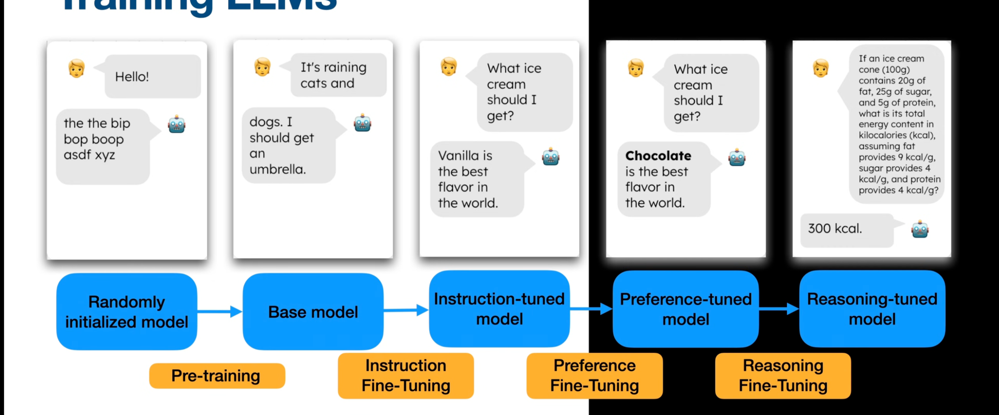
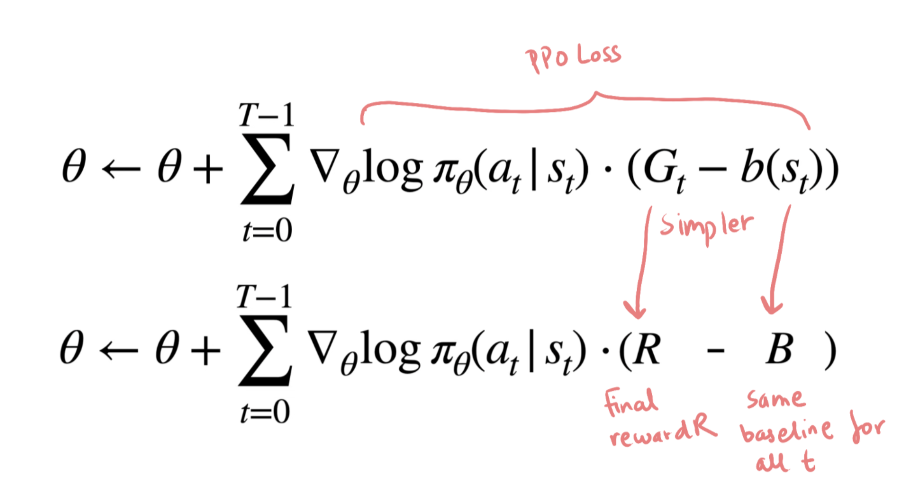
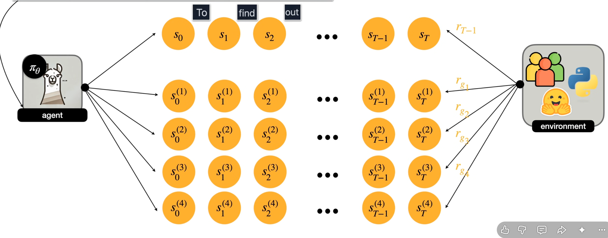
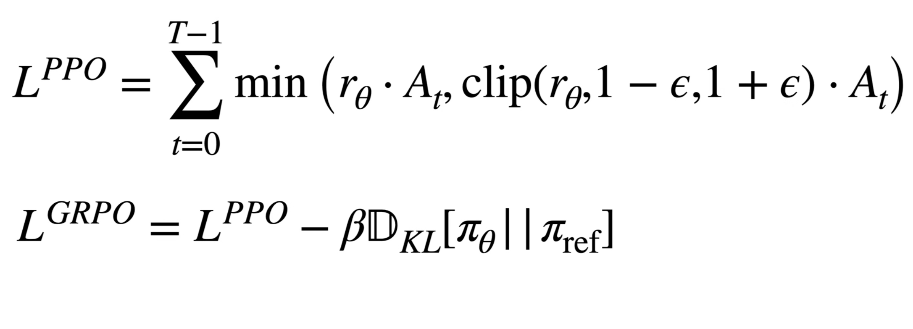

Notes from [video](https://www.youtube.com/watch?v=xT4jxQUl0X8)

Preference FineTuning
- PPO, GRPO, DPO are all in this stage
- GRPO is a successor to PPO.
- More advanced one is DPO (Direct Preference Optimization)

Reasoning-tuned model
- usually goal is binary so we can use this signal to better train
- RLVR(RL with Verifiable Rewards)
- RLVR also uses PPO, GRPO

Because G(t) and the baseline (Advantage) is probably wrong anyway because we estimate them and for language models it makes sense to embrace fact that the rewards dont come in intermediate steps.

How to calculate the baseline (B)?

Sample additional group(4-8) of trajectories, and compute their rewards and then average them.
This is why its called GRPO (Group relative!)

### DeepSeek team did try with intermediate rewards
Means use R(t) instead of R using a reward model to distribute the rewards to earlier steps.
its called GRPO with process supervision (confusing name).
Experiment says not worth it.

GRPO loss = PPO Loss - (beta hyperparameter) * KL divergence ( policy , policy before the whole update, not previous epoch before the whole training process)

We are trying to keep the policy (model) close to its original state. 
Given the oversimplification of the GRPO (removing state value function -> introduced variance), this KL divergence term tries to compensate.