Notes from [video](https://www.youtube.com/watch?v=8jtAzxUwDj0)

Turn LLM -> Reasoning model
Align LLM to human preference

Reinforcement Learning (agent acts then environment updates state)
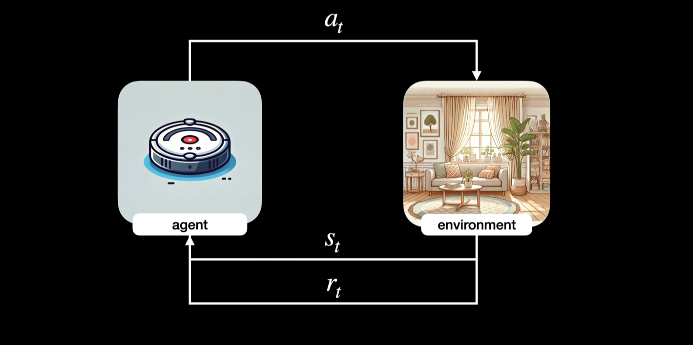

There is a dataset with reasoning traces (gsm8k).

RL State update = old tokens + new predicted token (llm decoding step)

so new token = action, state = accumulated tokens  

Rewards = compare final answer to ground truth

So all rewards are 0 until the last step (where its 1 if final answer is correct).
Some projects have external reward models to hand out rewards for each step as well.

How to distribute this reward to train in such a way that agent learns the desired behaviour? this is the holy grail of RL

To train a llm, we could use supervised way to compare each token to reference and then compare the distribution difference as loss for each step.
But we dont have this target distribution for the intermediate steps (in normal scenarios). So, PPO like algorithms how much the distribution should move (called advantage At). 

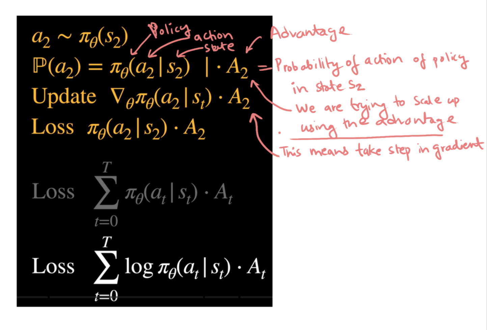

PPO from OpenAI, GRPO from deepseek
We dont know the correct action (like in supervised learning) so we just compare our action to the Average Action.

So, advantage in PPO = how much better was the action than the average?
So we must now define a Value function to how good a state is.

V(s), the action takes us to a new state and we can now evaluate how good the state is.

Model with Policy and Value both are called Actor(policy) Critic(value) model.
But how to find V? expanding it over the vocab (like a tree search) is impossible. We just estimate it and train it using Gradient Descent.

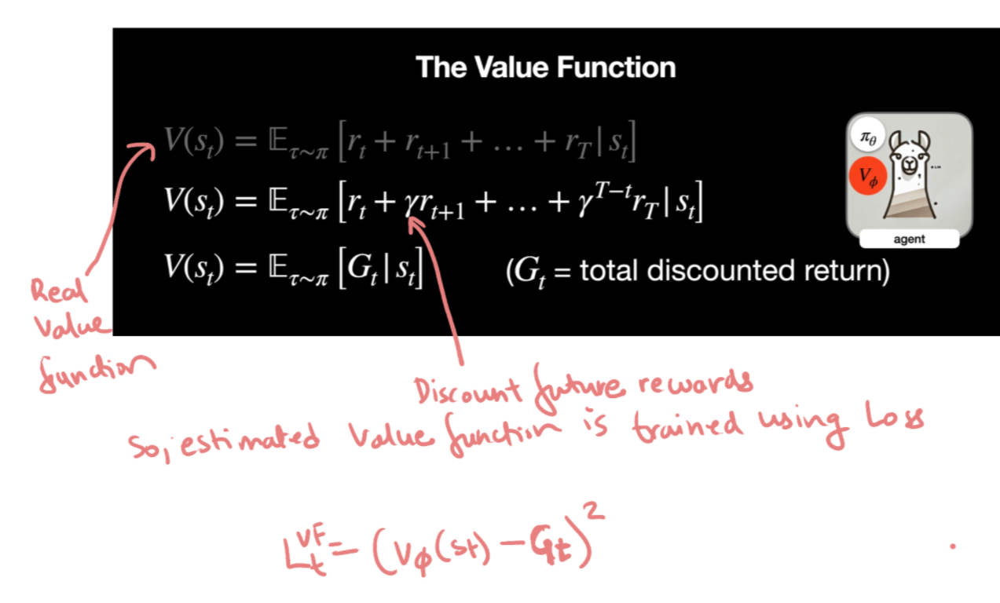
So using Gt (remember rewards for step 10 = 1) then that can be calculated using the discount factor and then loss can be computed for a previous step.

Now, PPO defines advantage as,
A = Q(s,a) - V(s)  
A = how much better than average is this action?  
but average action = Value function! (see above picture), V(s) = Expectation over all possible trajectories  
Q(s,a) = quality of action a in state s  

Different ways to calculate Q,  
-Monte Carlo approach:  
    let whole steps play out and sum over rewards with discount  
   this is not like the value function where we are taking expectation  
   we are only calculating for this specific run  
  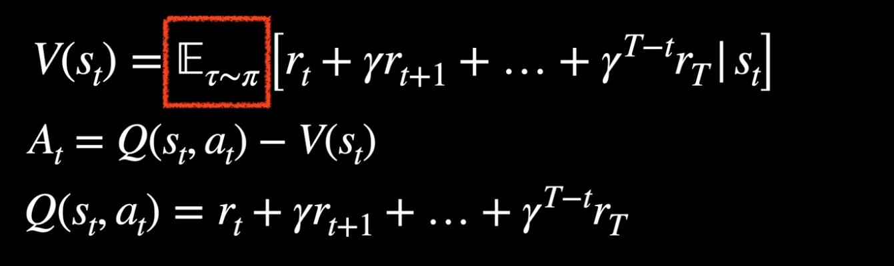
But we can approximate the Q using the value function like this. (not real Q just approximate)
  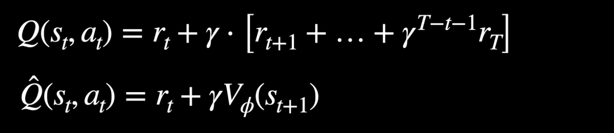
this is called bootstrapping and now we have Advantage (finally)
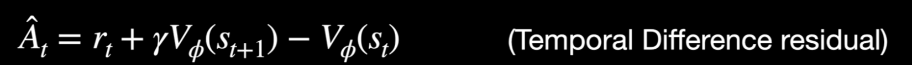

Thats the theory but in practice because sample sizes are small, and environments are diverse. So training is unstable.

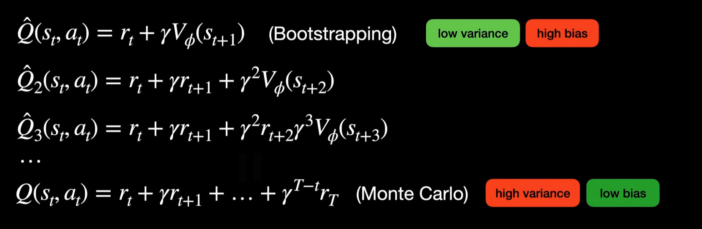

Upto which level do we use the real reward and estimate using value function will determine the models, variance and bias.

PPO will take these and use a exponentially weighted average of all A calculated from these Q 
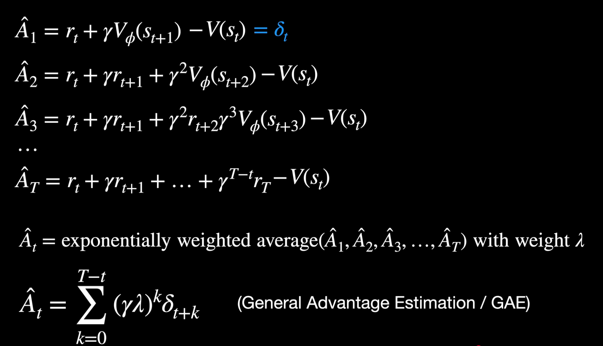

End to end training
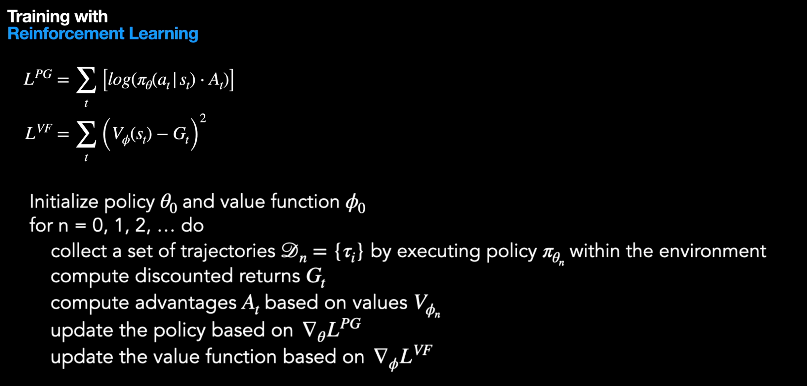

Once a trajectory is computed, we should do multiple iterations of updates, so recompute G and all the steps but that means we are updating the network with the prediction from old run. So, we must ajdust the loss, using something called Importance Sampling.

Allows us to estimate samples from p(x) using samples from q(x) by multiplying by p(x) / q(x)
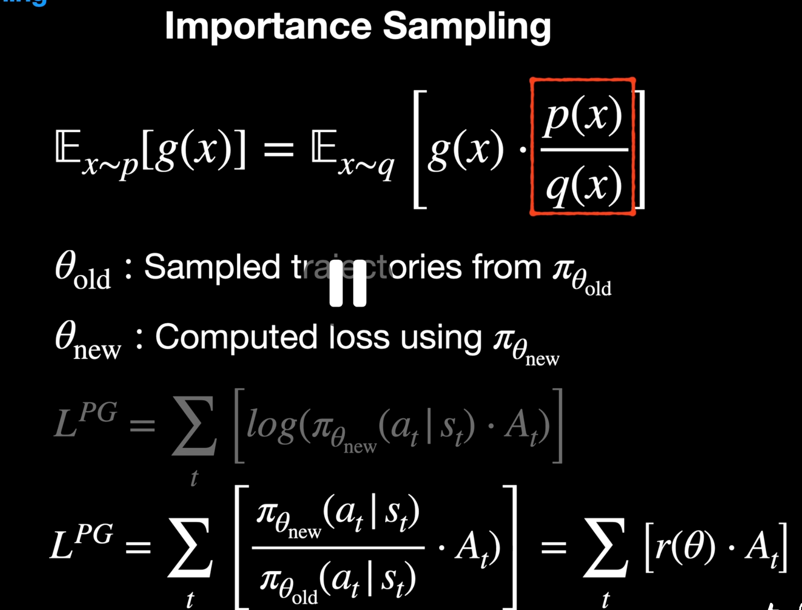

This is again an estimate called surrogate loss.

TRPO (trusted regions), defines somwhow using a region how far the new weights are allowed to be from the old ones during training. Uses 2nd order derivatives(hard to compute).

PPO uses clipping instead.
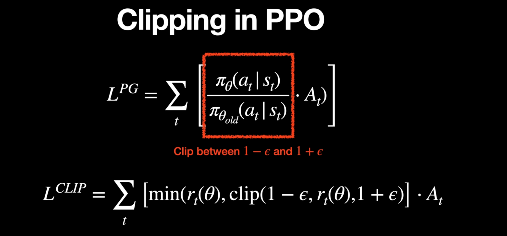

The importance sampling step has introduced a term in the loss where they control how much the weights can be changed. so PPO just does a min, with a parameter Epsilon (hyperparameter).

The PPO paper actually introduced the Clipping part all others were already existing techniques.