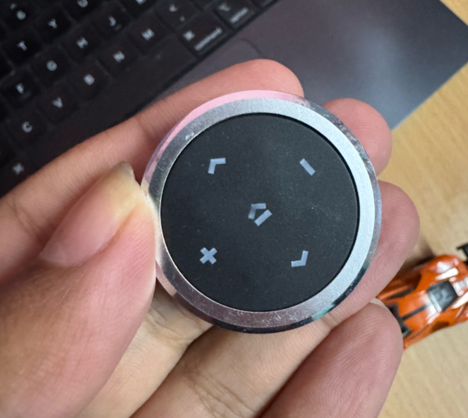
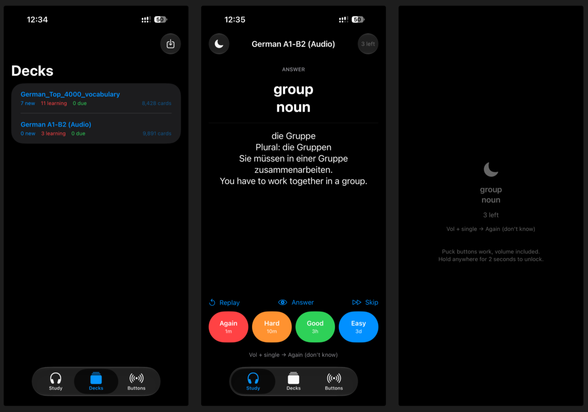
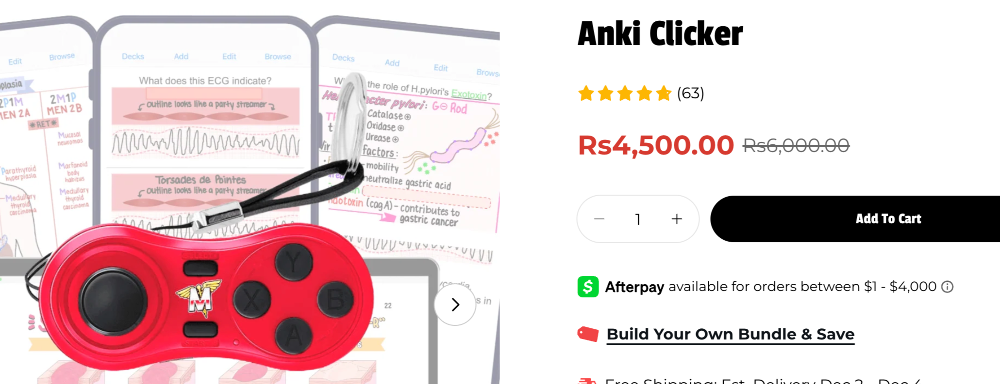

Do you like flash cards?  
Yeah, Anki, SuperMemo 2  and FSRS (Free Spaced Repetition Scheduler). They work.  
But, I never want to review them. I can't read books so I listen to audiobooks. Everyone has their own way of reading, I guess mine is audio.

I like to listen to audiobooks when I go for a walk. So, I had this idea why couldn't I port flashcards to audio. But, spaced repetition have the 4 buttons to press for the algorithm(all hail the algorithm) to work. 

I can't listen to a steady TTS speaking out my flashcards, it would be too monotonic. And I dont want to look at my screen while I'm walking/jogging.

So basically I want to press the 4 flashcard buttons while on the run. So a bluetooth device to press buttons while I run.

Bought this thing for like rs 1400. And it works sorta. I am hands free and I can control the flash cards app.  
I built (using claude ofcourse) an app that reads out the question of flashcard on `play` and double `play`(quick double tap can be mapped to a different functionality) it reads out the answer. And the 4 buttons are mapped to the 4 buttons of the flash cards. Works quite well for review. 

One gotcha I fell into was trying to lock my phone. You lose the volume +/- buttons if you lock your phone. On iPhone, the app doesn't receive the volume change buttons if the phone is locked. If its not locked then it works fine. So, the app implements its own lockscreen (last screenshot) to save battery and accidental touches, so the phone is unlocked technically but the app is locked.

After I discovered this on my own, I also found there are special devices for this exact stuff. Oh well!
